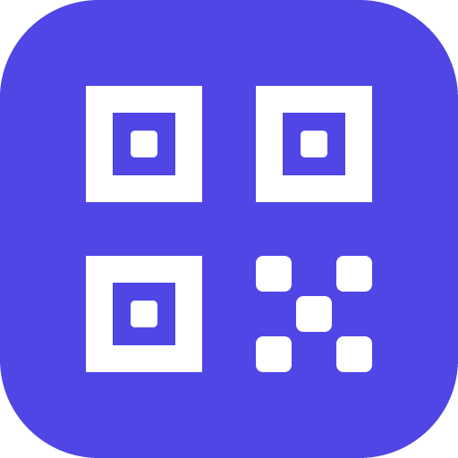

<h1 align="center">QR Generátor</h1>

  Generátor a čtečka QR kódů a generátor hesel pro Windows. 
  <a href="https://github.com/matous96/qr-generator/releases/latest"><b>Stáhnout nejnovější verzi</b></a>

---

## Co umí

- **QR kódy pro všechno běžné:** webová adresa, text, e-mail, telefon, SMS, vizitka
  (vCard / MeCard), QR Platba (SPAYD – číslo účtu se převede na IBAN a ověří), poloha,
  Wi-Fi, událost v kalendáři, sociální sítě, Bitcoin.
- **Kontrola čitelnosti:** každý kód se po změně zkusí přečíst, takže hned víte, jestli
  ho telefon načte. Upozorní i na nízký kontrast.
- **Čtečka QR kódů:** přečte kód z obrázku nebo ze snímku obrazovky (stačí Ctrl+V)
  a obsah otevře, zkopíruje nebo načte zpátky do generátoru.
- **Generátor hesel:** náhodné znaky, zapamatovatelná hesla z českých či anglických slov
  a uživatelská jména.
- **Vlastní vzhled:** barvy i přechody, průhledné pozadí, logo uprostřed, záhlaví s názvem
  služby, tvary bodů a rohů.
- **Hromadné kódy, šablony a historie.**
- **Export:** PNG (200–4000 px, 300 DPI), SVG, kopírování do schránky a tisk.
- **Čeština a angličtina:** podle jazyka Windows, nebo ručně.

## Instalace

Stáhněte `QR-Generator_<verze>_x64-setup.exe` z
[posledního vydání](https://github.com/matous96/qr-generator/releases/latest) a spusťte ho.
Instaluje se jen pro vašeho uživatele, bez práv správce.

Požadavky: Windows 10 nebo 11 (64bitové). Instalátor není digitálně podepsaný, proto
Windows SmartScreen může při prvním spuštění zobrazit upozornění („Další informace“ →
„Přesto spustit“).

Aplikace je zdarma. Problémy a nápady pište do [Issues](https://github.com/matous96/qr-generator/issues).

---

## English

**QR Generator** – a QR code generator and reader with a password generator for Windows.

- QR codes for links, text, e-mail, phone, SMS, contact cards (vCard / MeCard), Czech QR
  payments (SPAYD), location, Wi-Fi, calendar events, social networks and Bitcoin
- Every code is test-scanned after each change, with a low-contrast warning
- QR reader: decode a code from an image or a screenshot (Ctrl+V)
- Password generator: random characters, memorable passphrases, usernames
- Custom colors and gradients, transparent background, center logo, header, dot and
  corner shapes; batch codes, templates and history
- Export to PNG (up to 4000 px, 300 DPI), SVG, clipboard and print
- Czech and English interface

Download the installer from the
[latest release](https://github.com/matous96/qr-generator/releases/latest). It installs for
the current user only and doesn't need administrator rights. Requires 64-bit Windows 10
or 11. The installer isn't code-signed, so SmartScreen may show a warning the first time
(“More info” → “Run anyway”). Free to use.
